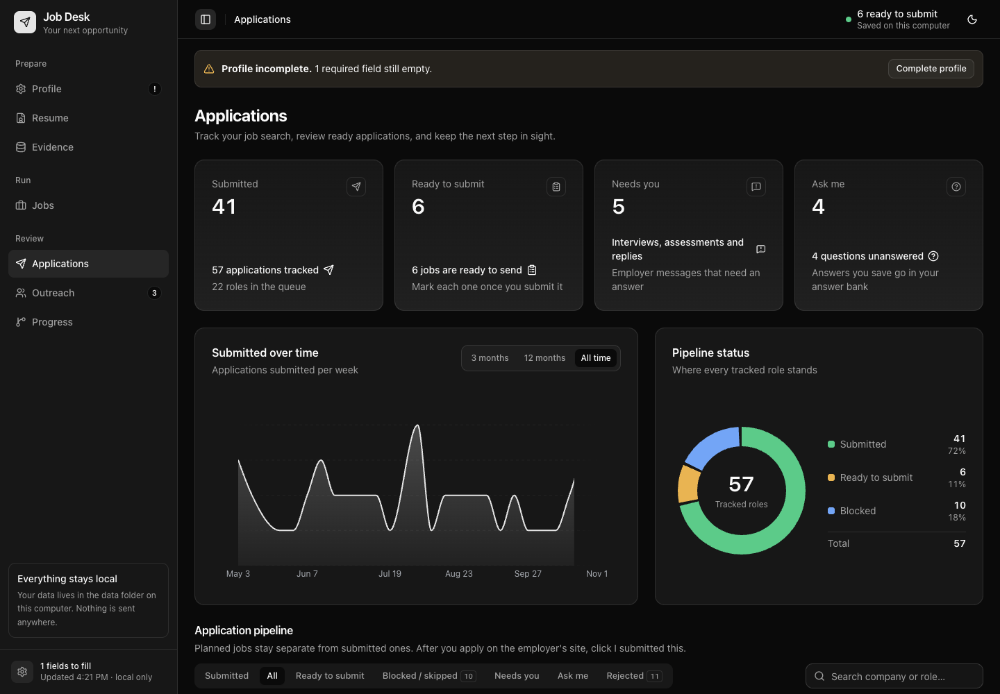

# Job Desk

A local dashboard for running a job search: track applications, follow up with
people at the companies you applied to, see the whole pipeline as a Sankey
diagram, and keep a store of evidence from your own repos and notes to back up
what your resume says.

Everything runs on your machine. The server is plain Node with no runtime
dependencies, and your data lives in JSON files under `data/`.



## Run it

Requires Node 20.19 or newer (Vite 7).

```sh
npm install
npm run build
npm start
```

Then open http://127.0.0.1:4400. Set `PORT` to use a different port.
`npm start` builds the dashboard first if `dist/` is missing.

On the first start the server writes a demo dataset into `data/` so every tab
has something to show. All of it is made up: fictional companies, fictional
people and `example.com` links. To wipe your data and start over from the demo:

```sh
npm run seed
```

## Tabs

| Tab | What it does |
| --- | --- |
| Applications | Stats, charts and the full application ledger. Mark a job as submitted, clear employer messages from "Needs you", and answer or skip open form questions. |
| Jobs | Add a job to track, browse matched postings with a score breakdown, track a posting, and rescan your evidence sources. |
| Outreach | People at the companies you applied to. Queue your top jobs, add a person to get a first draft, edit it, and record each step from approved to referral. Nothing is sent for you. |
| Progress | A Sankey view of every application and outreach record by current status. Exports to SVG. |
| Resume | Upload your base PDF and review keyword coverage per job, with each matched keyword checked against your evidence. |
| Evidence | Connect a local repo or a folder of notes. The scanner reads files (and git history for your own commits) and records facts with the file they came from. |
| Profile | Your contact details, education, eligibility and preferences. |

Add `?preview=1` to the URL for a larger, in-memory sample dataset. Preview mode
never writes anything.

## Where data lives

| File | Contents |
| --- | --- |
| `data/applications.json` | Tracked applications |
| `data/inbox.json`, `data/dismissed.json` | Employer messages and the ones you cleared |
| `data/needed.json`, `data/answers.json` | Open form questions and your saved answers |
| `data/outreach.json` | People and messages |
| `data/jobs.json` | Matched postings shown on the Jobs tab |
| `data/tailored.json` | Keyword coverage per job shown on the Resume tab |
| `data/profile.json` | Your profile |
| `data/corpus.json`, `data/corpus-sources.json` | Evidence store and its sources |
| `data/resumes/RESUME.pdf` | Your base resume |

`data/` is ignored by git, apart from the demo files in `data/seed/`.

For git facts (commit counts, lines changed) on a repo source, add the email
addresses you commit with to `author_emails` in `data/corpus-sources.json`.
Without them the scanner skips git history rather than guess which commits
are yours.

## Development

```sh
npm run dev:server   # API on :4400, restarts on change
npm run dev          # Vite on :5273, proxies /api to :4400
npm test             # API and flow-model tests
```

## Not in this build

Job discovery, automatic form filling and submission, AI resume tailoring and
LinkedIn automation are not included. The Jobs and Resume tabs read their
postings and coverage data from the JSON files above.

Third-party code notices are in [THIRD_PARTY_NOTICES.md](THIRD_PARTY_NOTICES.md).
